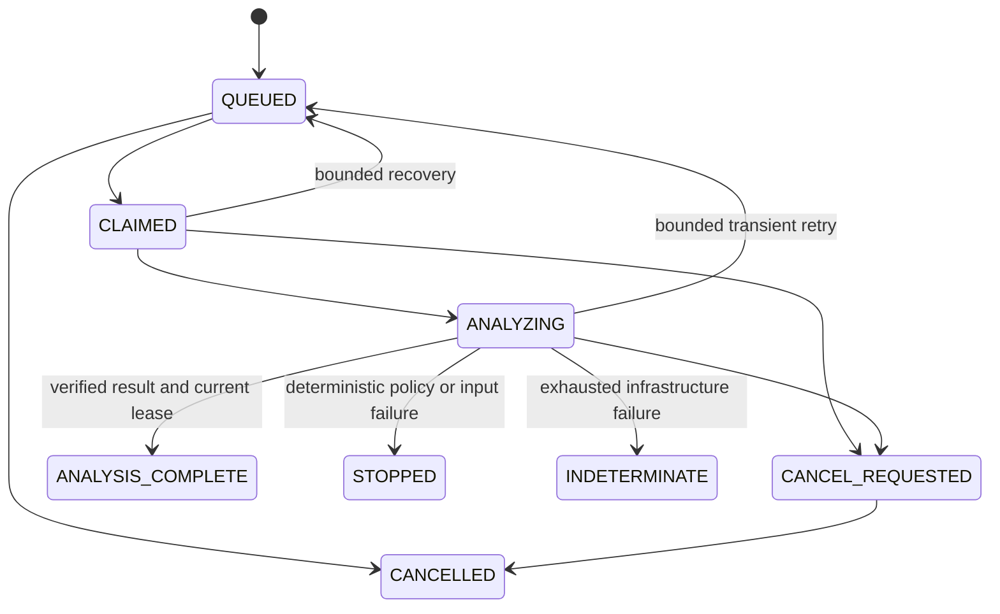

# Durable investigation state and identity

Phase 3 coordinates local static analysis. `ANALYSIS_COMPLETE` means that the unchanged
Phase 2 analyzer ran over the recorded input bytes and its result passed recomputation.
It never means that consumer code executed, an integration failed at runtime, or a patch
was verified. The stored result retains `replayExecuted=false`, `repairExecuted=false`,
and `modelInvocations=0`.

The authoritative state is PostgreSQL. The static dashboard does not read a live queue.
See [ADR 0003](adr/0003-durable-coordination.md) for the selected local architecture and
[the Phase 3 report](../PHASE_3_REPORT.md) for actual test and publication evidence.

## Different identities have different jobs

| Identity                               | Meaning and scope                                                                                         |
| -------------------------------------- | --------------------------------------------------------------------------------------------------------- |
| Workspace ID                           | Database-created singleton representing one trusted local operator; not authenticated tenancy             |
| Blob SHA-256                           | Identity of exact raw bytes; neither provider authenticity nor authorization                              |
| Input-set digest                       | Canonical sorted role/path/digest/length manifest bound to workspace, engine, policy and local trust mode |
| Request key                            | Canonical logical investigation identity; deduplicates identical submissions in that workspace            |
| Run ID                                 | Database-generated UUID of the canonical persisted investigation                                          |
| Optional idempotency token             | Operator convenience mapped to a request key; reuse with changed inputs is a conflict                     |
| Outbox event and inbox handler key     | Durable delivery identity; repeated delivery must not repeat the logical handler effect                   |
| Attempt ID, owner token and generation | One execution claim; every replacement claim increases the fencing generation                             |
| Phase 2 result digest                  | Identity of recomputed static evidence, independent of retries and timestamps                             |
| Stopped diagnostic digest              | Identity of a failure diagnostic, which can be equal for different failed input sets                      |

Source paths are relative evidence identities. After submission, a worker reads the CAS
manifest and blobs, not those original paths. Engine and policy identities are immutable
for a persisted request. Changing inputs or policy creates a different logical request.

## Allowed transitions

`contracts.ts` implements the pure transition function. The migration adds a PostgreSQL
trigger enforcing the same transition table and requiring each update to advance
`state_version` exactly once. Terminal rows cannot be changed into active rows.

| Current state       | Allowed next states                                                           |
| ------------------- | ----------------------------------------------------------------------------- |
| `QUEUED`            | `CLAIMED`, `CANCELLED`, `STOPPED`, `INDETERMINATE`                            |
| `CLAIMED`           | `ANALYZING`, `CANCEL_REQUESTED`, `QUEUED`, `STOPPED`, `INDETERMINATE`         |
| `ANALYZING`         | `ANALYSIS_COMPLETE`, `CANCEL_REQUESTED`, `QUEUED`, `STOPPED`, `INDETERMINATE` |
| `CANCEL_REQUESTED`  | `CANCELLED`                                                                   |
| `CANCELLED`         | None                                                                          |
| `ANALYSIS_COMPLETE` | None                                                                          |
| `STOPPED`           | None                                                                          |
| `INDETERMINATE`     | None                                                                          |

The table is exhaustive; the diagram highlights ordinary paths. Admission, expiry and
resource gates can stop work from earlier active states. A stopped diagnostic contains no
confident partial impact findings. Infrastructure ambiguity is not a reproduced failure.

## Transaction and lease rules

Submission stages verified input blobs before a short database transaction creates or
reuses the request, its immutable manifest, reservation, step, audit event and outbox intent.
A unique request constraint and the workspace budget lock serialize competing admissions.
Failure before commit can leave unreferenced CAS bytes; it cannot expose a committed run
whose inputs were never published. See [storage and retention](durable-storage-and-retention.md).

Queue consumption uses `FOR UPDATE SKIP LOCKED` for available work. A claim persists its
owner token, attempt ID, monotonically increasing generation and database-clock lease expiry.
Claim, heartbeat and finalization are short transactions. Parsing, recomputation and CAS
writes happen outside those transactions. The prescribed lock order is workspace budget,
run, then step/event; this keeps cancellation, claim and settlement from inverting locks.
The artifact-retention advisory lock uses a separate one-connection pool. Waiting for that
lock does not consume the four query-pool connections needed by its owner's transactions.

The authoritative completion predicate must match workspace, run, owner, generation,
unexpired database-clock lease and admissible state/version. Worker A cannot publish after
worker B replaces its expired claim. The same fence protects result references, terminal
audit and budget settlement. Extra computation or orphan blobs from A do not grant authority.
This is at-least-once execution with one accepted completion, not exactly-once execution.

An outbox intent survives a crash between submission commit and notification. Its delivery
counter is separate from analysis attempts. Inbox uniqueness prevents repeated notification
from repeating the handler effect. Requeue identities and retry scheduling remain separate
from deterministic input/result identities.

## Cancellation, retries and budgets

Cancellation is persisted with operator attribution. Cancelling queued work ends it without
claiming or executing it. Cancelling claimed/analyzing work records `CANCEL_REQUESTED`;
workers observe it and abort the trusted analysis thread when possible. Cancellation and
completion serialize on the same authoritative rows. A committed cancellation cannot later
be overwritten by success; an already committed terminal result stays terminal.

Only explicitly classified transient infrastructure failures are eligible for retry.
Unsupported contracts, malformed source, invalid manifest/artifact bytes, stale ownership
and Phase 2 deterministic `STOPPED` diagnostics are not silently retried as transient.
Backoff changes delivery timing, not evidence identity. Expired claims are reconciled under
the persisted attempt and overall deadline ceilings. Stale workers cannot refund reservations.
Each replacement claim receives only the remaining persisted compute allowance. A heartbeat
database error is preserved as an infrastructure failure rather than mislabeled as an
operator cancellation. Cancellation observed between claim and start is settled without
starting the analysis thread.

Default run ceilings are three attempts, 120,000 ms compute reservation, 120,000 ms elapsed
duration, 5,000 ms lease and 8 MiB combined output reservation. The trusted analysis thread
has its own maximum 30-second deadline covering analysis and recomputation. Default workspace
ceilings are 1,000 logical runs, two active workers, 128 MiB admitted bytes and 1,200,000 ms
compute. Lower limits can be selected; higher values are rejected. These are admission
limits, not a claim that V8 heap, native memory or CPU time is perfectly measured.

Admission reserves before enqueue. Terminal settlement releases the unused reservation once.
`compute_measured_ms` records observed elapsed work; `compute_estimated_ms` separately records
recovery estimates from database claim time after an interrupted worker. Neither is measured
CPU consumption. Admitted compute charges are capped by the reservation; separately retained
observations can show deadline/termination overhead beyond that charge. Successful completion
cannot consume more than the remaining allowance. SQL checks forbid negative or oversubscribed
counters and require settled consumed-plus-released totals to equal the reservation. Referenced input
and result storage is retained after cancellation or completion; it is not an automatic
refund of physical disk usage. Paid model, remote execution, external write and cloud
capabilities remain absent.

## Audit and evidence boundaries

Each transition has a monotonic per-run audit sequence bound to its state version. SQL
requires transition audit and both result/report references for `ANALYSIS_COMPLETE`.
Audit and artifact reference rows are append-only under runtime privileges. These are
local records; database owners can administer the database, and hashes do not create
cryptographically signed attestations.

Result read-back checks run scope/state, manifest identity, artifact bytes, schema, engine,
policy and exact recomputation. A self-consistent caller-provided digest is insufficient.
Missing or corrupt evidence is an explicit failure, never permission to reread changed
source paths or regenerate a convenient successful result. Deterministic stopped diagnostics
can be recomputed for diagnosis but never become successful cache keys.
The `durable:verify` CLI currently verifies completed investigations; the lower-level bounded
adapter also supports recomputing deterministic stopped diagnostics.

Required real PostgreSQL proofs are D06–D23 and D27 in the
[threat/failure matrix](durable-threat-failure-matrix.md). Their presence in this design
document is not a claim that a test ran; execution results belong in the phase report.
